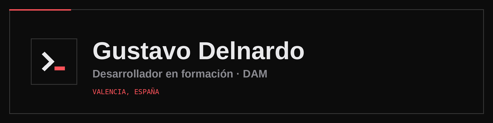

  

## Hola, soy Gustavo

Estudio segundo de Desarrollo de Aplicaciones Multiplataforma (DAM) en Valencia. Llegué a la programación por los videojuegos: de pequeño quería saber cómo funcionaban y ahora quiero aprender a hacerlos.

Antes de programar trabajé cinco años en Chile, primero repartiendo pedidos y después gestionando empresas que lo llevaban todo en papel y Excel. De esa etapa me traje la costumbre de no rendirme cuando algo no sale a la primera.

Además del desarrollo web y los videojuegos, me interesa la ciberseguridad.

## Proyectos

| Proyecto | Qué es | Tecnologías |
| --- | --- | --- |
| [ChopCheck](https://github.com/soytavodev/ChopCheck) | Aplicación para dividir la cuenta de una mesa entre los comensales, con panel para el camarero | PHP, MySQL, JavaScript |
| [GuessIt](https://github.com/soytavodev/GuessIt) | Juego de preguntas con cuentas de usuario y ranking | PHP, MySQL |
| [ChangeIt](https://github.com/soytavodev/ChangeIt) | Conversor de divisas con una API pública | PHP, API REST |
| [Analizador-ids](https://github.com/soytavodev/Analizador-ids) | Detector de intrusos para logs web, por reglas y con IA local | Python, SQLite, Ollama |
| [DeepLens](https://github.com/soytavodev/DeepLens) | Genera capturas de las pantallas de un proyecto web a partir de su código, con IA local | Python, Ollama, Playwright |
| [personal-site](https://github.com/soytavodev/personal-site) | Mi web personal y portfolio | React, TypeScript, Vite |

Capturas y más detalles en [mi portfolio](https://gustavo-delnardo.vercel.app/portfolio).

## Ahora mismo

- Estoy en 2.º de DAM en CEAC FP (Valencia).
- Hice las prácticas en empresa en JOCARSA (marzo–junio de 2026): scripts en Python para analizar código, un catálogo web con PHP y SQLite y pruebas con modelos de IA en local.
- Voy subiendo aquí los proyectos que hago para practicar.

## Tecnologías

  
  
  
  
  
  
  
  
  
  
  

## Contacto

- Web: [gustavo-delnardo.vercel.app](https://gustavo-delnardo.vercel.app)
- LinkedIn: [Gustavo Delnardo](https://www.linkedin.com/in/gustavo-delnardo-2b2990397/)
- Correo: [gustavoedv35@gmail.com](mailto:gustavoedv35@gmail.com)
- CV: [descargar en PDF](https://gustavo-delnardo.vercel.app/cv-gustavo-delnardo.pdf)
